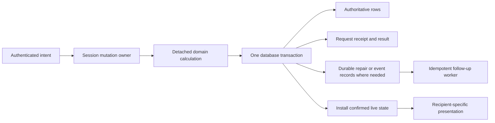

# Architecture research and risk assessment — 2026-10-23

The highest-priority work is to unify combat persistence ownership, repair cross-resource consistency, and apply authorization to every event producer. These problems affect correctness even with a single trusted group. The existing React/FastAPI/PostgreSQL/Rust split is suitable; the evidence supports improving its boundaries incrementally.

This is a historical assessment of the October 23 source revision. Several
findings have since been fixed. See the [functional release implementation
plan](FUNCTIONAL_RELEASE_ARCHITECTURE_PLAN_2026-10-26.md) for reassessed status,
implementation progress, and remaining release gates. The linked JSON evidence
records the original audit, not the current application's behavior.

## Scope, evidence, and Git result

- Date: October 23, 2026, Europe/Kiev.
- Audited source revision: `f752eb8ff6ea3ec533676f6c9c07df70d2d4f105`, including the 13 commits still local after the requested push. Findings describe this local revision, rather than only the published subset.
- Indexed and searched all **68 Markdown files / 11,259 lines** in `docs/current`. Read the architecture, persistence, protocol, security, operations, command/history, and relevant feature contracts in detail, then traced their claims through implementations and regression tests. This is a targeted architecture audit, not an exhaustive review of every source line.
- Researched official Python, FastAPI, SQLAlchemy, PostgreSQL, AWS, Microsoft, React, and OWASP guidance. Recommendations below distinguish source-confirmed behavior, reproduced failures, and conditional future requirements.
- Existing uncommitted WASM artifacts and older untracked reports were preserved. No application implementation was changed to remediate these findings. The new scripts are isolated investigation tools.
- No production database, R2 bucket, hosting dashboard, or deployed configuration was inspected. Provider recovery settings and actual capacity remain unverified.

All **22 previously unpublished commits** were redated to October 23 for both author and committer, retaining their original local times, messages, identities, order, and file trees. Original history is preserved on `backup/unpublished-before-redate-2026-10-23-dfff9dbe`. A normal fast-forward push published exactly the oldest nine:

| New commit | Subject |
| --- | --- |
| `712bc99e` | fix(previews): close gestures with trusted canonical identities |
| `5e3b16ce` | fix(previews): use relative leases and expire queued samples |
| `bd9a3ca0` | feat(observability): add bounded opt-in command timing samples |
| `086493a1` | fix(sync): start acknowledgement watchdogs at first transmission |
| `3fe6ef17` | fix(sync): recover on validated progress and fence preview scopes |
| `7ebff054` | test(postgresql): verify bulk sprite durability and history recovery |
| `241f8999` | docs(sync): describe latency limits recovery and timing verification |
| `c1ecad57` | test(sync): validate multi-client convergence over real sockets |
| `384c96fe` | feat(canvas): fence pipelined edits with committed predecessors |

`origin/main` is now `384c96fe7d07544c143135e65405e1be762ff5be`; local `main` is ahead by 13. The rewritten tip has exactly the same tracked tree as the saved original tip.

## Priorities and estimates

P1 means correctness work to prioritize now or a blocker for the specified release scope. P2 means planned reliability or maintainability work. Public-service and scaling requirements are explicitly conditional: the documented immediate scope is one trusted session.

Estimates are **engineer-days**, assuming a contributor familiar with this repository, roughly six focused hours per day, and an available reviewer. They include implementation, relevant regression tests, migration work where needed, and documentation. They are planning ranges, not measured delivery commitments; allow about 20% contingency for integration and review. Provider procurement and waiting time are excluded.

| ID | Problem | Priority / trigger | Estimate |
| --- | --- | --- | --- |
| A1 | Combat engine commits before command acceptance | P1, trusted play | 3–5 days |
| A2 | Table, character, token, and combat state have separate consistency boundaries | P1, trusted play | 8–15 days |
| A3 | Combat cancellation can release ordering before a worker settles | P1, abnormal cancellation | 2–4 days |
| A4 | Remaining synchronous database work stalls the whole server loop | P1, responsiveness | 3–6 days |
| A5 | Some event producers bypass visibility policy | P1, private data | 3–6 days |
| A6 | Account WebSockets retain authority beyond token expiration | P1 before public use; P2 for trusted play | 1–3 days |
| A7 | Independent database-plus-object recovery is not implemented | P1 before production | 8–15 days |
| A8 | Durable request identity and outcome recovery vary by domain | P2; prioritize irreversible operations | 5–9 days |
| A9 | Reusable Python package depends on server infrastructure | P2, maintainability/reuse | 6–12 days |
| A10 | Browser core has 39 detected import cycles | P2, maintainability | 5–10 days |
| A11 | Existing PostgreSQL behavior suites are omitted from the configured CI gate | P1 validation improvement; P2 structural gap | 2–4 days |
| A12 | One global application writer limits deployment and capacity options | P2; scaling work conditional | 2–4 days to measure; 20–40 additional days if partitioning is required |

The independent base estimates total **48–93 engineer-days**, excluding optional horizontal scaling and full adversarial fog confidentiality. With 20% contingency that is approximately **58–112 engineer-days**. Implementation can share transaction, event, and test infrastructure, but that saving should be estimated after A1–A3 establish the chosen boundary.

## A1. Combat lifecycle has two persistence owners

**Confirmed and reproduced with real isolated SQLite.**

The command service presents a journal/snapshot transaction as the acceptance point, but lifecycle calls already commit their own changes:

- [combat_command_service.py](../server/service/combat_command_service.py), lines 836–854: start/end call the engine directly.
- [combat_engine.py](../server/service/combat_engine.py), lines 79–91, 159–171, and 277: start, end, and round transitions can write independently.
- [database/crud.py](../server/database/crud.py), lines 1170–1194 and 1230 onward: those helpers commit their sessions.
- [combat_command_service.py](../server/service/combat_command_service.py), lines 427–440 and 1186–1190: a later journal failure restores the in-memory snapshot, without undoing the earlier lifecycle commit.

The probe injected failure into `persist_accepted` after a real start save. The command returned `accepted=false`, the live cache was removed, but SQLite contained one active encounter and zero journal entries. `CombatEngine.restore` then resurrected the rejected combat. Existing success/rollback tests passing does not establish this missing invariant.

**Recommended solution:** make engine operations calculate state without persistence. The application command service should own one transaction for the encounter snapshot, command identity, and journal result, and publish/install accepted state afterward. Keep any compatibility persistence entry points explicitly outside this command path. Test failed start, failed end, round rollover, duplicate lifecycle commands, and restart after each failure.

An alternative is compensating lifecycle writes, but that introduces another failure-prone write and still needs durable reconciliation. The single-owner change is smaller and clearer here. SQLAlchemy documents transaction-scoped session ownership; that supports keeping one explicit application boundary around acceptance. [SQLAlchemy session guidance](https://docs.sqlalchemy.org/en/20/orm/session_basics.html).

**Effort:** 3–5 days. Completion means a rejected lifecycle command cannot reappear or disappear after reconstruction from the database.

## A2. A game action can span independently committed resources

**Confirmed by implementation; failure exposure extends beyond A1.**

- Combat token movement is wired through `move_sprite` in [protocol/combat.py](../server/service/protocol/combat.py), lines 245–268, while the combat journal commits later in [combat_command_service.py](../server/service/combat_command_service.py), lines 1281–1296.
- Compensation in that service, lines 1304–1316, attempts reverse movement and silently ignores compensation exceptions. Restoring the combat cache therefore cannot prove that token persistence was restored.
- Character updates commit before `_sync_character_stats_to_tokens` in [protocol/characters.py](../server/service/protocol/characters.py), lines 574–585. Token synchronization is a separate transaction in [character_protocol_persistence_service.py](../server/service/character_protocol_persistence_service.py), lines 39–64. Synchronization exceptions are logged and swallowed at characters.py:935–936.
- Active combat keeps another stat snapshot. There is no single transaction coordinating these representations. [Current sprite documentation](../../docs/current/features/SPRITES_TOKENS_AND_ENTITIES.md) acknowledges this boundary.

**Impact:** a character save can succeed while linked tokens retain old HP/AC, or a rejected combat action can leave a durable token move. A subsequent snapshot may treat the stale representation as current. This affects ordinary trusted play during database failures.

**Recommended solution:** first define stat authority: for example, the active encounter owns encounter HP/action state; the character owns persistent character attributes; token fields are projections with explicit source/version. Then implement an application unit of work for effects that must commit together in the same PostgreSQL database. Existing CRUD helpers need a staging mode that does not commit internally.

For projections that may lag, commit a durable repair/event record with the source change and process it idempotently. The project already has a useful example in its asset deletion outbox. An outbox handles reliable follow-up work; it does not make two independently committed authoritative changes atomic. [AWS transactional outbox guidance](https://docs.aws.amazon.com/prescriptive-guidance/latest/cloud-design-patterns/transactional-outbox.html).

A smaller alternative is a durable saga with recorded compensations and a reconciliation state. Choose that only where a single database transaction cannot reasonably cover the effect.

**Effort:** 8–15 days, assuming A1 establishes combat ownership first. Include failure injection between each write, restart recovery, and reconciliation of existing inconsistent rows. Existing restrictions on live terrain edits should remain until their transaction is covered.

## A3. Worker cancellation and session ordering have different lifetimes

**Confirmed and reproduced through the real protocol dispatch lock with injected storage.**

[utils/blocking.py](../server/utils/blocking.py), lines 64–89, correctly keeps a running thread alive and holds worker capacity after its awaiting coroutine is cancelled. However:

- [protocol/base.py](../server/service/protocol/base.py), lines 288–320, protects sprite, wall, settings, and batch handlers through settlement; `COMBAT_COMMAND` is outside that explicit protection.
- [combat_command_service.py](../server/service/combat_command_service.py), lines 427–440, catches `Exception`, which does not catch `asyncio.CancelledError`.
- Its state-version installation happens after the awaited worker returns, at lines 1297–1302.

The probe cancelled a combat dispatch while its persistence worker was blocked. The session mutation lock released before the worker settled. The worker later returned version 1, while the live combat stayed at version 0. Another operation can now run against an incompletely settled predecessor.

**Important scope:** ordinary socket teardown already drains in-flight inbox work in [websocket_inbox.py](../server/service/websocket_inbox.py), lines 102–109. This finding concerns cancellation of the dispatch task or a containing scope, including forced lifecycle/error handling. It does not claim every normal disconnect triggers the defect.

**Recommended solution:** give each accepted mutation one lifetime covering staging, database settlement, cache installation, and event publication. Preserve the session lock until that lifetime ends, then propagate cancellation. Pass detached inputs to workers. Reuse the existing settlement pattern rather than merely adding `shield()` around a thread await: shielding the inner task alone still permits cancellation of its caller. [Python cancellation and shielding semantics](https://docs.python.org/3.11/library/asyncio-task.html).

**Effort:** 2–4 days. Verify cancellation before admission, during SQL, after commit, and during publication, including repeated cancellation.

## A4. Some async handlers still perform synchronous database I/O

**Confirmed; choice-handler blocking reproduced.**

- [protocol/encounter.py](../server/service/protocol/encounter.py), lines 17–44 and 83–91, calls synchronous load/save methods directly from async handlers.
- [choice_encounter_persistence_service.py](../server/service/choice_encounter_persistence_service.py) performs synchronous ORM queries and commits behind those calls.
- [protocol/helpers.py](../server/service/protocol/helpers.py), lines 125–150, has synchronous permission fallback queries.
- [game_session_protocol.py](../server/service/game_session_protocol.py), lines 149–150 and 190–196, performs join-time lookup/restoration work.
- A1's engine persistence is also synchronous on the command path. Migrating only `persist_accepted` does not remove those earlier calls.

With an injected 120 ms choice-storage delay, an independently scheduled 10 ms heartbeat ran at **122 ms**, and the storage call ran on the event-loop thread. This demonstrates scheduling behavior, not production database latency. A slow query can pause sockets and unrelated sessions in the one application process.

**Recommended solution:** move complete synchronous I/O boundaries through the existing bounded `run_blocking` mechanism. Create/close the ORM session inside the worker; return detached results and update shared caches on the event loop. Keep mutation settlement compatible with A3. FastAPI only automatically offloads functions it invokes as synchronous routes/dependencies; arbitrary synchronous utility calls inside an async handler remain direct calls. [FastAPI concurrency guidance](https://fastapi.tiangolo.com/async/).

An all-async SQLAlchemy migration is an alternative, but is broader than needed to fix these paths. It also does not remove the requirement for separate sessions per concurrent operation.

**Effort:** 3–6 days, excluding the lifecycle transaction refactor counted in A1. Require heartbeat tests around slow choice/join/permission paths and a two-session responsiveness test.

## A5. Authorization depends on which producer emits an event

**Confirmed and reproduced for hidden-token stat synchronization.**

[protocol/characters.py](../server/service/protocol/characters.py), lines 904–925, sends linked-token stat updates using `broadcast_to_session`, without checking each token's authoritative layer. [game_session_protocol.py](../server/service/game_session_protocol.py), lines 305–315, enqueues that broadcast for every session client. Its separate `broadcast_filtered` method is not used by this producer.

The probe supplied a token on `dungeon_master`, invoked the real stat-sync producer and real session broadcaster, and observed the token ID and HP in messages addressed to **owner, player, and spectator**. This contradicts the intended private-layer event policy even though dedicated sprite-event tests pass. It is a disclosure within an authorized session, not evidence of cross-session access.

There is a related, broader boundary: [protocol/tables.py](../server/service/protocol/tables.py), lines 298–322, filters sprite layers but sends the wall collection, and wall events send wall dictionaries. Client-side fog cannot hide data already delivered to the browser. Some geometry may intentionally be required for local lighting/collision, so full secret-world confidentiality is a separate product/design decision.

**Recommended solution:** centralize recipient presentation for sprite-derived events. Every producer, including character sync, combat, snapshots, and background repair, should resolve the authoritative table/layer and use the same policy. Add a matrix covering producer × role × layer, and include role changes and unloaded tables. OWASP recommends authorization for each WebSocket action; here the same discipline must cover outbound data access. [OWASP WebSocket guidance](https://cheatsheetseries.owasp.org/cheatsheets/WebSocket_Security_Cheat_Sheet.html).

**Effort:** 3–6 days for consistent enforcement of the existing role/layer contract. If supporting adversarial players requires withholding unseen geometry, budget a separate **10–20 days** for threat modelling, server-side projections, and compatible lighting/movement behavior; that work is excluded from the totals.

## A6. WebSocket account authority has no token-expiration deadline

**Source-confirmed; not exercised against a live signed-token socket in this audit.**

[authentication.py](../server/service/authentication.py), lines 29–62, validates JWT expiration and account state during authentication. However, [api/game_ws.py](../server/api/game_ws.py):

- stores user/role and only `guest_expires_at` in the handshake context, lines 40–45;
- omits the account token's expiration when creating that context, lines 106–112;
- waits indefinitely for ordinary account messages when `guest_expires_at is None`, lines 240–254.

Password/account revocation has active socket-close mechanisms, which should be preserved. The gap is expiration of an already accepted account credential: the configured six-hour HTTP token lifetime does not impose the same lifetime on an established game socket. Token expiry is checked again only on a new handshake.

**Recommended solution:** carry a validated expiration deadline into connection context, close the socket at expiration, and make the browser reauthenticate/reconnect. If long games need renewal, define an explicit refresh/reauthentication flow. Avoid adding a database query on every frame; a deadline plus existing revocation notifications is sufficient for the current single-process scope. OWASP specifically recommends handling session expiration on long-lived connections. [OWASP session handling](https://cheatsheetseries.owasp.org/cheatsheets/WebSocket_Security_Cheat_Sheet.html).

**Effort:** 1–3 days. Acceptance needs a real socket with a short-lived valid token, expiry while idle and while sending, and separate guest behavior.

## A7. Production recovery has no independent, rehearsed contract

**Confirmed repository gap; actual provider backups remain unknown.**

[BACKUP_AND_RESTORE.md](../../docs/current/operations/BACKUP_AND_RESTORE.md), lines 5–6 and 65–77, explicitly records the missing production backup. Repository scripts/workflows contain migration, cutover, and storage checks, but no complete independent PostgreSQL-plus-R2 backup and restore pipeline.

A database restore alone cannot recreate deleted asset bytes. Conversely, a bucket copy alone cannot recover the corresponding metadata, memberships, upload intents, deletion jobs, and writer state. Live deletion workers also need a defined relationship with the chosen recovery point.

**Recommended solution:** define RPO/RTO and use an independent encrypted relational backup plus an immutable asset inventory/copy with a shared recovery manifest. Record schema/release identifiers and checksums. Start with a controlled write-pause recovery point if that makes correctness reviewable; move to continuous recovery only when required. Rehearse restoration into a fresh database/bucket with deletions paused until integrity checks complete. PostgreSQL documents both logical backup and continuous archival recovery; select a mechanism compatible with the managed provider. [PostgreSQL backup and recovery](https://www.postgresql.org/docs/17/continuous-archiving.html).

The operational path also needs repair: [scripts/r2_storage_admin.py](../../scripts/r2_storage_admin.py), lines 188–207, writes its audit through an ordinary session, while [database/writer.py](../server/database/writer.py), lines 64–83 and 104 onward, requires writer-aware transaction handling. The existing docs acknowledge this incompatibility. Provide a maintenance adapter that respects fencing without taking over live writer ownership; rehearse its audit behavior against PostgreSQL.

**Effort:** 8–15 days, including backup automation, the necessary maintenance adapter, alerts, and one clean restore drill. Do not count provider time-travel availability as proof of independent recoverability.

## A8. Reliable command identity stops at domain boundaries

**Confirmed, with existing successful mechanisms that can be reused.**

Canvas, paint, raw sprite edits, chat, and combat already have forms of durable identity/replay. The live-socket suite verifies a committed edit whose receipt was lost. The problem is incomplete coverage, rather than absence of command recovery throughout the project.

Examples outside those guarantees:

- [protocol/characters.py](../server/service/protocol/characters.py), lines 715–755, loads the current XP and saves `current_xp + amount`. A second newly processed request can award again; it is not tied to a durable award identity.
- [protocol/tables.py](../server/service/protocol/tables.py), new-table handling, creates a new resource without a common durable create receipt. [Current table docs](../../docs/current/features/TABLES_AND_CANVAS.md) tell the user to reload after uncertain creation.
- Settings have confirmed-write and cancellation protection, but [current settings docs](../../docs/current/features/SETTINGS_AND_CUSTOMIZATION.md) still require manual reconciliation for unknown outcomes.

**Impact:** after losing an acknowledgement, the user cannot consistently determine whether retrying duplicates an effect. The common browser mutation ledger tracks pending work, but cannot manufacture a durable server outcome.

**Recommended solution:** inventory mutations by retry semantics, then prioritize XP awards, resource creation, and destructive/admin actions. Store authenticated scope + operation identity + request digest + result in the same transaction as the effect. Reuse the original identity on retry, reject changed parameters under the same identity, and expose bounded outcome lookup/reconciliation. AWS recommends caller-provided request identity with atomic recording of the effect and identity. [AWS idempotent API guidance](https://aws.amazon.com/builders-library/making-retries-safe-with-idempotent-APIs/).

**Effort:** 5–9 days for the high-risk missing domains, assuming A1/A2 provide transaction ownership. Verify lost receipts, process restart, altered duplicate payloads, actor scope, and retention policy. This estimate is not for a complete event-sourcing rewrite.

## A9. The Python domain package cannot fully operate independently

**Confirmed by source and an isolated import check.**

- [core_table/server.py](../../packages/core-table/core_table/server.py), lines 107–179, imports server CRUD and worker infrastructure.
- [wall_commands.py](../../packages/core-table/core_table/wall_commands.py), lines 27–49, imports SQLAlchemy, server database modules, and `utils.blocking`.
- [token_resolution_service.py](../../packages/core-table/core_table/compendiums/token_resolution_service.py), lines 15–16, imports server `database` modules at import time.
- [core-table/pyproject.toml](../../packages/core-table/pyproject.toml) declares only `jsonschema` as a runtime dependency. The intended infrastructure-free contract is explicitly incomplete in [ADR-005](../../docs/current/decisions/ADR-005-core-table-is-reusable-domain-logic.md).

In an isolated Python invocation with only the package source added, importing the token resolver fails with `ModuleNotFoundError: No module named 'database'`. This does not mean pure rules modules are unusable; it demonstrates that the advertised package boundary is incomplete.

**Recommended solution:** define small persistence/asset lookup ports, implement them in `apps/server`, and inject them into application services. Move worker/session/transaction ownership into the server. Keep rules, entities, validation, and protocol data in the package. Add a clean wheel-install test with only declared dependencies and import boundaries. Microsoft's domain design guidance supports placing infrastructure behind interfaces while keeping domain dependencies independent; that principle can be applied inside this monolith. [Domain and infrastructure dependency guidance](https://learn.microsoft.com/en-us/dotnet/architecture/microservices/microservice-ddd-cqrs-patterns/ddd-oriented-microservice).

An alternative is to declare the package intentionally server-internal and remove the independent-reuse claim. That reduces packaging promises but does not resolve the current transaction ownership split.

**Effort:** 6–12 days. Prioritize adapters touched by A1/A2/A4 instead of relocating the whole package at once.

## A10. Browser dependency cycles couple state, transport, runtime, and UI

**Measured: 39 cycles across 672 analyzed files.**

The Madge scan uses the actual TypeScript config and resolves aliases. Three virtual/test modules were skipped, so the result describes the graph Madge resolved, not a proof that every runtime import was examined. Full evidence is in [import-cycles.json](audit/architecture-2026-10-23/import-cycles.json).

Representative loops include:

```text
providers/index → AuthProvider → store → lib/api/index → providers/index
clientProtocol → movementCommand.service → clientProtocol
runtime/index → WasmRuntime → features/assets/index → AssetManager
  → useAssetManager → runtime/index
```

[store.ts](src/store.ts), lines 1–9, imports protocol and runtime services. [WasmRuntime.ts](src/lib/wasm/runtime/WasmRuntime.ts):1 imports the broad assets barrel. [vite.config.ts](vite.config.ts), lines 54–62, explicitly groups the store/protocol/WASM core into one chunk to accommodate circular imports.

**Impact:** startup/import order becomes part of behavior, infrastructure imports feature UI through barrels, and test isolation requires wider mocking. The cycle count itself is not evidence that the current app fails to start. Existing lifecycle tests and bundling workarounds mitigate some symptoms.

**Recommended solution:** inject protocol/store adapters at the provider composition root. Keep state reducers free of transport execution; give the runtime a narrow asset port; import specific leaf services rather than UI barrels. Ratchet the existing dependency graph in CI while removing strongly coupled groups incrementally. Preserve the separate confirmed baseline and pending-intent projection required by collaborative editing. React's guidance to reduce redundant state supports clear ownership, but does not imply that an optimistic projection should be deleted. [React state structure guidance](https://react.dev/learn/choosing-the-state-structure).

**Effort:** 5–10 days for the core loops and an enforceable boundary gate. Verify startup, provider disposal, reconnect, and table switching before changing chunk configuration.

## A11. CI has PostgreSQL infrastructure but skips relevant existing suites

**Confirmed from workflow and skip conditions.**

[ci.yml](../../.github/workflows/ci.yml), lines 170–179, sets `TEST_POSTGRESQL_DATABASE_URL` only for the explicit migration/contract/writer-fencing selection. That selection omits:

- [test_canvas_history_postgresql.py](../server/tests/integration/test_canvas_history_postgresql.py), whose module skips without that environment variable;
- PostgreSQL parameterizations in [test_multiclient_sync.py](../server/tests/integration/test_multiclient_sync.py):35–36.

The later broad pytest step has no such variable. Consequently these paths are present in the repository but not exercised by the checked-in workflow's PostgreSQL gate. Additional manual/external runs may exist; none were inspected.

**Recommended solution:** include both suites in the disposable PostgreSQL step, publish pass/skip counts, and fail if expected PostgreSQL cases all skip. Add the A1/A3/A5 reproductions as appropriate permanent regressions when fixing them. Extend scheduled/release acceptance to a served multi-domain playthrough, restore drill, and realistic multi-session load. Existing browser/WASM and live-socket suites should be retained.

**Effort:** 2–4 days for gate wiring, skip assertions, and stable artifacts. The production restore drill is counted in A7; a full provider-backed scenario may need additional provisioning time.

## A12. Scaling requires changing ownership, not increasing workers

**Confirmed design limit; current capacity is unknown.**

[database/writer.py](../server/database/writer.py), lines 42–79, claims one application-wide writer generation. [migrate_and_start.py](../server/scripts/migrate_and_start.py) explicitly starts one worker; [render.yaml](../../render.yaml) sets one instance. Live tables, combat, socket indexes, and revocation delivery reside in process memory. [WRITER_HANDOVER.md](../../docs/current/operations/WRITER_HANDOVER.md) correctly documents these constraints.

This is a coherent safety choice for the immediate scope. Its consequences are a single failure domain, bounded vertical capacity, and reconnects during handover. Simply enabling multiple workers would cause ownership replacement and independent live caches. FastAPI documents that worker processes do not share normal application memory. [FastAPI deployment concepts](https://fastapi.tiangolo.com/deployment/concepts/).

**Recommended next step:** keep one writer and measure representative session count, active clients, scene size, command bursts, event-loop lag, lock wait, worker wait, memory, reconnect, and database latency. Existing loopback/delay tests are useful correctness evidence, not a capacity statement. Publish a supported workload and rejection/recovery behavior.

If measurements require horizontal scaling, prefer one fenced owner per session partition, explicit command routing, durable per-session ordering, shared event/revocation distribution, and generation-aware hydration. Keep cross-session asset quotas in their database transaction boundary. Redis pub/sub or sticky routing alone does not establish exclusive ownership or durable ordering.

**Effort:** 2–4 days for a capacity model and repeatable load experiment; **20–40 additional days** for a first partitioned deployment with failover tests. Defer partitioning until a workload or availability requirement justifies it.

## Implementation sequence

1. **Trusted-play correctness: 14–28 days before contingency.** A1, A3, A4, A5, A6, and A11. Start with the reproduced rejected-start and hidden-token disclosure, wire the existing PostgreSQL suites, then close the remaining lifetime and blocking gaps.
2. **Durability and production readiness: 21–39 additional days.** A2, A7, and A8. Agree on stat authority, introduce the shared transaction/repair model, make high-risk retries safe, and rehearse recovery.
3. **Maintainability and capacity evidence: 13–26 additional days.** A9, A10, and A12's measurement work. Extract only the adapters needed by ongoing changes, reduce dependency cycles, and publish the supported workload.

For a public release, bring A6 and A7 forward as release prerequisites. For a private trusted group, backups and disclosure fixes remain valuable, while full adversarial fog confidentiality and session partitioning can wait.

The target mutation boundary is:



The existing canvas/wall settlement mechanisms and asset deletion outbox provide starting points. Preserve current server authority, writer fencing, bounded queues, per-socket delivery, schema validation, and the typed WASM boundary.

## Documentation drift and secondary operational work

Some current documents lag newer code. Treat their TODOs as research leads rather than automatically confirmed defects:

- SERVER_ARCHITECTURE, BATTLE_FLOW, and TRUSTED_SESSION_SCOPE still list synchronous wall writes. `wall_commands.write_wall` already runs a worker-owned transaction before live publication, with cancellation settlement.
- Older persistence/scope TODOs broadly say ordinary canvas commands lack durable receipts. Newer COMMAND_AND_HISTORY/ACTION_CONFIRMATION and the implementation contain durable canvas and sprite receipts. A8 is limited to domains still lacking them.
- `scripts/check_docs.py` validates links/metadata, not the truth of behavioral claims. It passes while these semantic inconsistencies remain. Update the affected claims alongside their owning code; allow approximately 0.5–1 day within the documentation portions of the implementation estimates.
- The legacy SQLite importer rejects every nonempty model table in [import_sqlite_to_postgresql.py](../server/scripts/import_sqlite_to_postgresql.py):526–549. Migration-seeded singleton tables therefore conflict with its empty-target policy, as DATABASE_MIGRATIONS documents. If importing legacy data is required, budget **2–4 additional days** to preserve seeds, respect writer fencing, and rehearse on a disposable PostgreSQL schema. This conditional work is excluded from the base total.
- Existing inline CSP allowances and process-local auth/demo rate limits remain documented hardening items. This audit did not establish an XSS exploit or a deployed abuse condition, so they are not promoted above the reproduced correctness and disclosure defects.

## Verification performed and reproducibility

Environment: Windows, Python 3.11.14, pytest 9.1.1, Node 24.11.0. Investigation used only local source, isolated storage, and public documentation. Versions are the local execution environment, not a claim about deployment.

| Check | Result |
| --- | --- |
| Combat command, encounter protocol, blocking limiter, WebSocket security suites | 90 passed |
| Sprite event visibility, token-stat persistence, wall persistence, canvas pipeline/commands, combat persistence suites | 119 passed |
| Real-socket multi-client suite | 4 passed, 4 PostgreSQL cases skipped because no test PostgreSQL URL was supplied |
| Existing documentation checker | Passed |
| Madge import scan | 672 files, 39 cycles; three skipped virtual/test modules |
| Isolated token-resolver import | Reproduced missing server `database` dependency |
| Four audit failure probes | All reproduced the asserted current behavior |

That is **213 existing tests passed and 4 skipped**. No PostgreSQL test was counted as passing through SQLite. No full browser/WebGL suite, production restore, or provider capacity test was run; there was no application change requiring a rebuilt WASM artifact.

Probe details are in [verification-results.json](audit/architecture-2026-10-23/verification-results.json). The scripts assert the current defects, so they are investigation tools rather than passing remediation acceptance tests. Convert the relevant cases into tests asserting correct behavior when implementing fixes.

Run from `apps/web-ui`:

```powershell
& ..\..\.venv311\Scripts\python.exe audit/architecture-2026-10-23/verify_findings.py
node audit/architecture-2026-10-23/inspect-imports.mjs
```

The Python script explicitly selects in-memory SQLite and injected boundaries. Its cancellation case uses actual protocol locking with a simulated commit result; its character disclosure case uses the real producer/broadcaster with a simulated token lookup. The rejected-start case writes and reloads real ORM rows in isolated SQLite. The 122 ms heartbeat measurement is one local injected-delay sample.

Existing server suites were run from `apps/server` with `DATABASE_URL=sqlite:///:memory:` and an empty `DATABASE_MIGRATION_URL`:

```powershell
python -m pytest tests/unit/test_combat_command_service.py tests/unit/test_encounter_protocol.py tests/unit/test_blocking.py tests/unit/test_game_ws_security.py --no-cov -q --tb=short
python -m pytest tests/unit/test_sprite_event_visibility.py tests/unit/test_character_protocol_persistence_service.py tests/unit/test_wall_command_persistence.py tests/unit/test_canvas_pipeline.py tests/unit/test_canvas_command_service.py tests/unit/test_combat_persistence.py --no-cov -q --tb=short
python -m pytest tests/integration/test_multiclient_sync.py --no-cov -q --tb=short
```

From the repository root, `python scripts/check_docs.py` passed. Git checks confirmed nine commits between the original remote tip and the pushed tip, thirteen remaining local commits, and no tracked-tree difference between the old and rewritten local tips.
